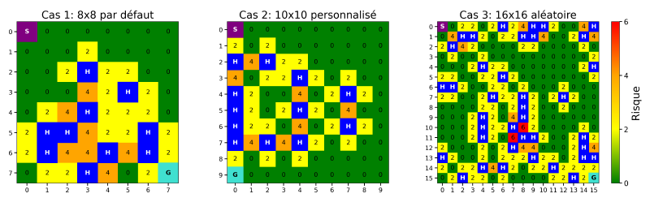

# SafeRL-IFT-7201

A comparative study of reinforcement learning approaches (Q-learning, PPO, and P30) for learning safe policies in stochastic environments. We use the non-deterministic [FrozenLake-v1](https://gymnasium.farama.org/environments/toy_text/frozen_lake/) environment from the Gymnasium library (Towers et al., 2024).

The Q-learning implementation is adapted from a tutorial available on the [Gymnasium website](https://gymnasium.farama.org/tutorials/training_agents/frozenlake_q_learning/#sphx-glr-tutorials-training-agents-frozenlake-q-learning-py).

PPO is implemented using the [Stable-Baselines3](https://stable-baselines3.readthedocs.io/) library (Raffin et al., 2021), with default hyperparameters except for the neural network architecture.

We implemented P3O within the Stable-Baselines3 framework, drawing inspiration from the implementation in the [OmniSafe](https://github.com/PKU-Alignment/omnisafe) library.

The figure below shows risk maps for the three case studies. S = starting state; G = goal; H = hole. The remaining cells indicate the risk level, defined as twice the number of holes adjacent to the current cell. The third case study shows one of the ten randomly generated 16 × 16 environments.



For more details and results, see `FINAL_REPORT_fr.pdf`.

## Project Structure

```
SafeRL-IFT-7201/
├── environments.py                             # Definition of wrapped FrozenLake environments
├── utils.py                                    # Utility functions
├── train_ppo.py                                # PPO training script (Proximal Policy Optimization)
├── train_q_learning.py                         # Q-learning training script
├── train_p3o.py                                # P3O training script (Penalized Proximal Policy Optimization)
├── model_p3o.py                                # Implementation of the P3O algorithm based on the Stable-Baselines3 architecture
├── generate_train_plots.py                     # Script for generating training plots
├── generate_train_plots_param_search.py        # Script for generating hyperparameter search plots
├── Visualize_environments_and_policies.ipynb   # Notebook for visualizing the case studies and learned policies
├── pyproject.toml                              # Dependency configuration (uses `uv`)
├── FINAL_REPORT_fr.pdf                             # Final project report
├── README.md                                   # This file
```

## Installation

This project uses **`uv`** for dependency management. Make sure `uv` is installed before following the steps below.

### Requirements

- Python ≥ 3.12
- `uv` installed ([documentation](https://docs.astral.sh/uv/))

### Install dependencies

```bash
# Install the project dependencies in the virtual environment
uv sync
```

## Usage

### Train a PPO / Q-learning / P3O model

```bash
uv run train_ppo.py
uv run train_q_learning.py
uv run train_p3o.py
```

### View TensorBoard logs

```bash
# Launch TensorBoard to visualize the training metrics
tensorboard --logdir ./<algorithm>_<env_type>/

# Example:
tensorboard --logdir ./ppo_8x8_default/
```
